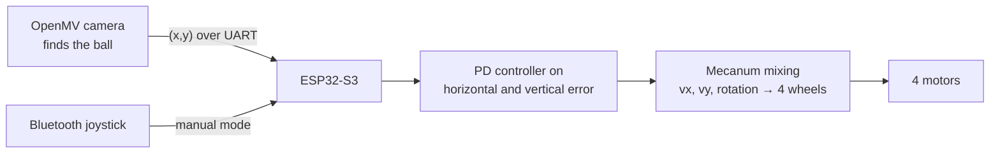

# RoboFut — Omnidirectional Autonomous Soccer Robot

A soccer robot for UABC's **CRODIT** robotics team (2026). Four mecanum wheels let it move in any direction, and an **OpenMV** camera finds the ball and steers the robot toward it.

## Hardware
- **ESP32-S3** on a custom PCB
- 4 DC motors with encoders on **mecanum wheels** (omnidirectional drive)
- **BNO08x** IMU for heading
- **OpenMV** camera at 320×240, sending the ball's position over UART
- Bluetooth joystick (RemoteXY) for manual mode
- RGB status LED, battery monitor

## How it works

- The camera sends `(x,y)` for the ball's center, or `(0,0)` when it can't see it.
- A PD controller turns the error from the image center into forward, sideways and turning speeds. Mecanum mixing splits those into the four wheel commands. A minimum PWM overcomes motor dead-zone friction.
- When the ball is lost, the robot falls back to the joystick (main firmware) or searches toward the last side where it saw the ball (behaviors below).

## Code
| Folder | What it does |
|---|---|
| [`firmware/ROBOFUT_FINAL/`](firmware/ROBOFUT_FINAL) | Main firmware: camera parsing, PD ball chasing, mecanum drive, Bluetooth manual mode |
| [`firmware/behaviors/omnifut_misil/`](firmware/behaviors/omnifut_misil) | "Missile": always advances toward the ball, slow and steady; turns toward the last side it saw it |
| [`firmware/behaviors/omnifut_seguir/`](firmware/behaviors/omnifut_seguir) | Follow the ball |
| [`firmware/behaviors/omnifut_seguir_buscar/`](firmware/behaviors/omnifut_seguir_buscar) | Follow, and search when the ball is lost |
| [`firmware/behaviors/omnifut_porteria/`](firmware/behaviors/omnifut_porteria) | Goal-oriented behavior |
| [`firmware/behaviors/omnifut_recto/`](firmware/behaviors/omnifut_recto) | Straight-line drive test for motor calibration |
| [`camera/openmv_ball_tracker.py`](camera/openmv_ball_tracker.py) | OpenMV color-blob ball tracker that speaks the same `(x,y)` protocol (simplified version) |

Arduino IDE settings for the ESP32-S3: board "ESP32S3 Dev Module", Flash 16 MB, USB mode "Hardware CDC and JTAG". Libraries: Adafruit NeoPixel, RemoteXY.
